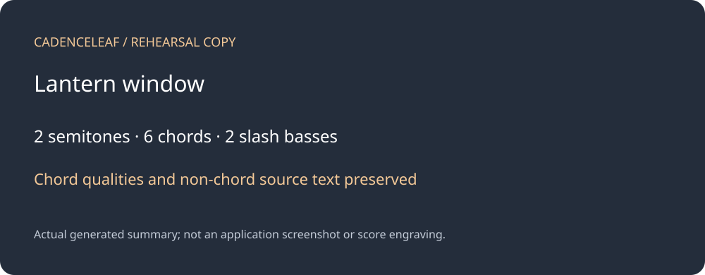

# Cadenceleaf

A new key. The same words.

**[Open Cadenceleaf](https://cadenceleaf.vercel.app)**

Cadenceleaf makes a clear rehearsal copy from your own bracketed chord-and-lyric text. Shift chord roots and slash basses by semitones, choose a readable color and size, and download a portable sheet with a complete change receipt.



This is a generated example export. A native application screenshot, browser visual checks, assistive-technology checks, native downloads and physical printing remain unverified. Automated UI checks use a simulated DOM.

## What it does

- Edit lyrics with chords placed immediately before their syllables: `[C]At the window, [Am7]lanterns glow.`
- Transpose supported chord roots and slash basses from −12 to +12 semitones.
- Prefer sharp or flat root/bass spellings, while preserving chord qualities.
- Show chords above lyric chunks, with blue, copper or black ink.
- Choose compact, standard or large lyric text.
- Switch to a local rehearsal view with an explicit exit button.
- Review every original and resulting chord, its source position, quality and bass.
- Download complete .cho text, styled HTML, a project, a JSON receipt or a summary SVG.

Processing stays in your browser. There are no accounts, uploads, analytics, external fonts, runtime dependencies or saved song libraries. Download a project before closing; there is no autosave.

## Run locally

Use Node.js 22 or 24 and npm:

```sh
npm ci --ignore-scripts --no-audit --no-fund
npm test
npm run build
npm run dev
```

Open **http://127.0.0.1:4217**. The workspace starts with an original fictional rehearsal example.

The build copies eleven allowlisted static assets into `dist/`. The pinned jsdom development dependency is used only by tests. No environment variables or paid services are required.

## Make a rehearsal copy

1. Type your own text or open a supported UTF-8 chord text file.
2. Put each chord in brackets immediately before the syllable where it belongs. Literal bracketed stage directions should use `[*direction]`.
3. Choose a whole-semitone shift. Every build uses your original source, so repeated builds do not accumulate transpositions.
4. Choose root/bass spelling, chord color and lyric size.
5. Select **Make rehearsal copy**. Review the rendered sheet and complete chord receipt.
6. Download a project to keep the original source and settings; use the .cho or styled HTML file for a portable playing copy.

Edits disable downloads and rehearsal view until another successful build. Invalid drafts leave the last successful copy visible, explicitly marked as a previous copy. Unsupported input is rejected rather than partially transposed.

Receipt filters and pages affect only the table. All exports contain the complete built sheet. Rehearsal view is a layout change in the same page, not a privacy boundary, separate device display or fullscreen mode.

## Supported notation

Cadenceleaf implements a deliberately small **ChordPro-style subset**, not the complete ChordPro specification or its reference formatter. The [official format introduction](https://www.chordpro.org/chordpro/chordpro-introduction/) explains bracketed chords and directives; the [official chord documentation](https://www.chordpro.org/chordpro/chordpro-chords/) describes a wider grammar than this app supports.

### Chords

A chord consists of:

- An uppercase A–G root, optionally followed by one ASCII `#` or `b`.
- One supported quality from the list below.
- An optional slash bass using the same root-note grammar.

Examples: `[C]`, `[F#m7]`, `[Bbmaj7/D]`, `[Am7b5/G]`.

Supported qualities, including an empty suffix for a major chord:

```text
(empty) m min maj dim aug sus2 sus4
5 6 7 9 11 13 m6 m7 m9 m11 m13
maj7 maj9 maj11 maj13 dim7 m7b5
7b5 7#5 7b9 7#9 7sus4 add2 add9 madd9
```

Chord qualities are preserved verbatim. For example, `Fmaj7/A` shifted up two semitones becomes `Gmaj7/B`. This is a pitch-class transformation, not a voicing or fingering calculation.

A zero shift preserves every original spelling. A nonzero shift uses a fixed sharp or flat pitch-class table, including at ±12 semitones. Thus `Cb` at +12 can become `B`; these are the same pitch class. Reversing a shift restores pitch classes and qualities, not necessarily original enharmonic spellings.

There is no key detection, diatonic spelling, octave tracking, harmonic validation, capo adjustment, tablature transposition, audio pitch shifting or instrument-specific advice. Symbols such as `H`, Unicode accidentals, double accidentals, `C6/9`, arbitrary quality names and numeric/Roman chords are unsupported.

### Annotations, lines and directives

- `[*Softly]` and `[N.C.]` are displayed as annotations and left unchanged.
- Blank lines create vertical space.
- Lines whose first non-space character is `#` are source remarks. They remain in .cho/project/receipt exports and are omitted from the playing view.
- Supported text directives are `{title: text}`, `{subtitle: text}` and `{comment: text}`.
- Supported section pairs are `{start_of_verse}` / `{end_of_verse}` and `{start_of_chorus}` / `{end_of_chorus}`. They must match and cannot nest.
- Bracket-like text inside remarks and text directive values is literal and is not transposed.

Other directives are rejected, including key, capo, transpose, chord definitions, diagrams, grids, tab blocks and formatter settings. This avoids exporting stale musical metadata or silently ignoring behavior the app cannot interpret.

Literal braces and backslash escape syntax in lyric lines, unmatched/nested brackets and empty chord brackets are rejected. Put stage directions in annotations or comment directives. Markup-like lyric text is displayed literally here, not executed or styled. Other ChordPro programs may interpret markup differently.

## Preservation and audit

Transposition replaces only the supported bracketed chord spans in the source. Lyrics, whitespace, blank lines, remarks, directives and annotations outside those spans remain unchanged in the .cho output.

Source LF/CRLF line endings and an optional leading BOM are retained. Project metadata edits preserve raw source line endings; editing the textarea itself uses the browser's LF normalization.

A separate audit parses source and output, then verifies:

- Every original chord occurrence remains present and in order.
- Root and bass pitch classes move by the requested amount.
- Qualities and the presence of slash basses stay unchanged.
- Root/bass spellings follow the selected policy, with exact preservation at zero.
- Every non-chord source span remains identical.
- Every before/after row agrees with its source occurrence.

The audit does not establish that the arrangement sounds right. Source columns are 1-based UTF-16 code-unit positions, not visual columns or grapheme counts.

## Appearance and printing

The playing copy places chords above their following lyric chunks. Each chunk reserves enough width for its chord, which may add space between words. Long chunks can wrap. This is a readable browser layout, not a score engraving engine, fixed-column import converter or exact layout match for another ChordPro application.

The three lyric sizes are 18, 22 and 26 pixels; chord text scales with them. The same sheet styles are used by the exported HTML. Open the HTML in a browser to review it or use its print dialog. Browser paper settings, font metrics and color-printing policies can change the result. Check print preview; page count, wrapping, printer color and device behavior have not been verified.

No PDF generator, autoscroll, performance timer, pedal support, audio player, song database or external-site importer is included.

## Limits

- 100,000 UTF-16 code units in source and transposed output.
- 400 source lines, including a trailing empty line after a final newline.
- 1,000 chord occurrences, with at most 32 characters in each chord name.
- Annotation text: 1–80 characters.
- Rehearsal title: 80 characters; notes: 500.
- Source import: 400,000 bytes. Project import: 2,000,000 bytes and 500,000 decoded code units.
- Strict UTF-8 imports; optional leading BOM; LF or CRLF. Lone CR, unsafe ASCII controls, unpaired surrogates and U+FFFE/U+FFFF are rejected.
- Non-Latin lyrics and emoji are supported; chord roots use the ASCII grammar above.

Large sources that would grow beyond the output cap are rejected without an export. Files using additional ChordPro features must be simplified intentionally or opened in a fuller formatter.

## Exports and examples

| Download | Contents |
| --- | --- |
| `rehearsal.cho` | Complete transposed source, retaining supported directives and source formatting |
| `cadenceleaf-sheet.html` | Standalone styled sheet; expandable full receipt and original source; notes included |
| `cadenceleaf-project.json` | Complete original source, settings and notes for reopening |
| `cadenceleaf-receipt.json` | Project, output, parsed playing lines, all occurrence rows and statistics |
| `cadenceleaf-summary.svg` | Actual checked transformation summary, not a screenshot or score |

Projects, receipts and the HTML review include the original lyrics and private notes. Collapsed content is still present in the file. Sharing them shares that material.

The [examples](examples/) are five actual generated artifacts from original fictional text. The example shifts six chords up two semitones, including two slash basses. Run `npm run example` to regenerate the files.

## Verification

`npm test` passes **24 automated checks**: 13 core checks, 10 simulated UI checks and their parent test.

- 34,650 root/quality/shift/spelling cases checked against an independent pitch table.
- 1,050 whole-sheet cases through the independent audit.
- Twelve deliberately damaged transformations rejected.
- Complete exports, zero-shift identity, reverse-shift pitch equivalence, BOM and mixed line endings.
- Unsupported notation and resource limits, strict encoding, literal HTML/XML and all display variants.
- Actual Blob payloads under receipt filtering, paging, rehearsal focus/exit, invalid drafts and asynchronous file-read races.

GitHub Actions tests and builds on Windows and Linux with Node 22 and 24. The UI checks simulate DOM events; they do not verify native browser visuals, assistive technology, touch behavior, actual download destinations or printed output.

## Manual Vercel setup

Import this repository into your Vercel account. Use the repository root, **Other** framework, Node **24.x**, build command `npm run build` and output directory `dist`.

The checked-in `vercel.json` supplies the build and security headers. No runtime dependency installation, environment variables or paid resources are needed. After deployment, check the example, imports, rehearsal view and downloaded files in your browser.

## License

[MIT](LICENSE). Use lyrics and arrangements you wrote or have permission to process. Cadenceleaf includes no external song collection.
